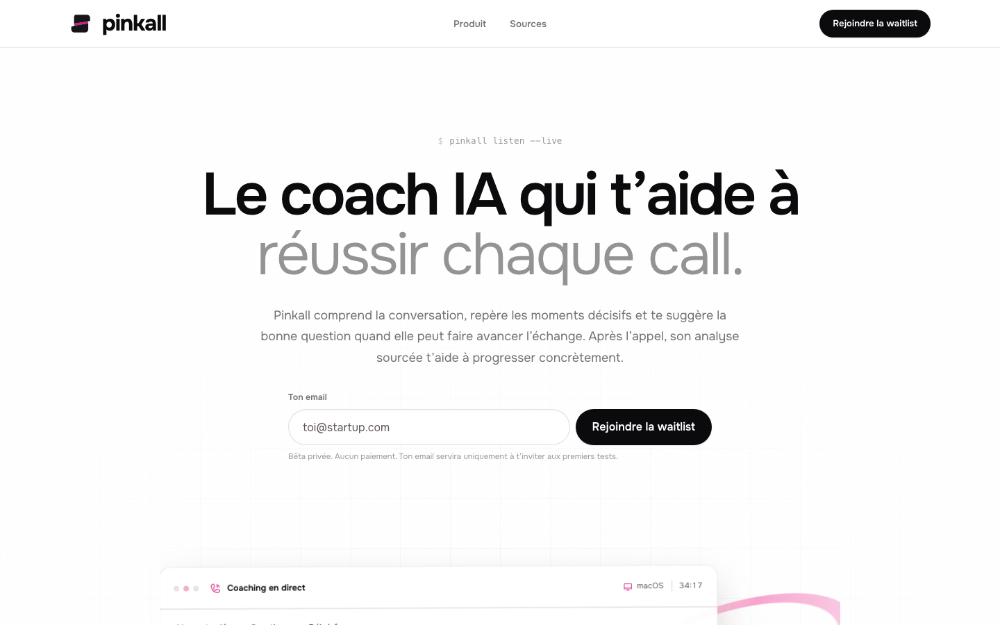
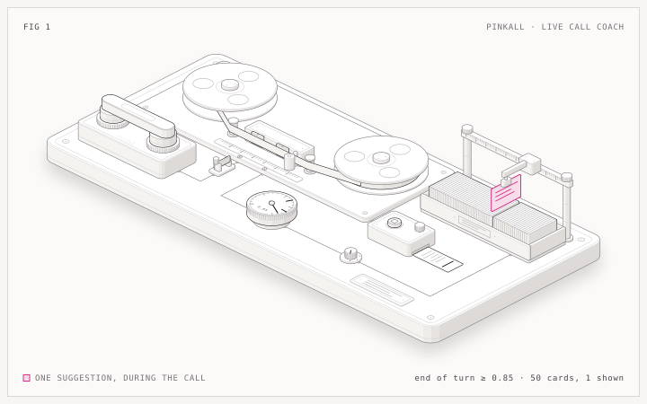
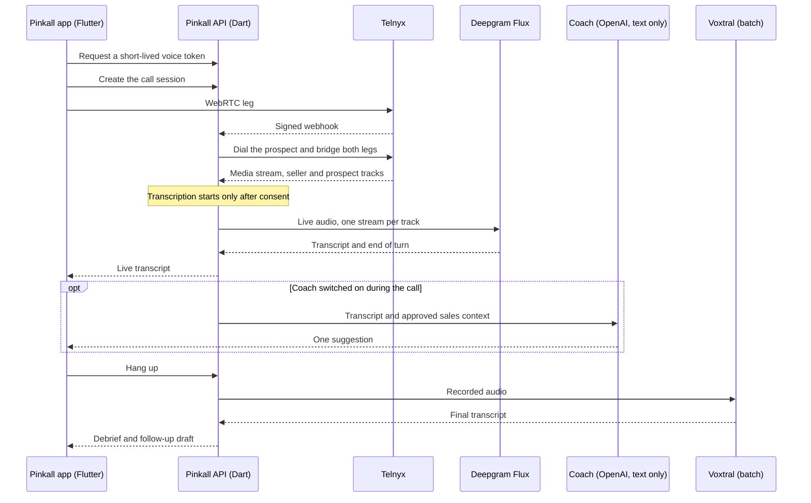
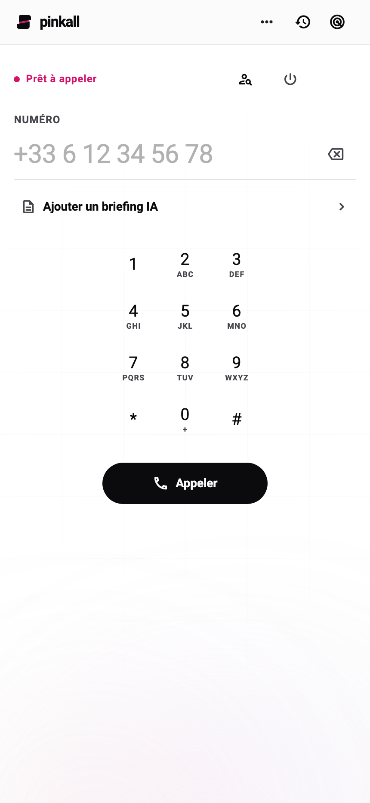
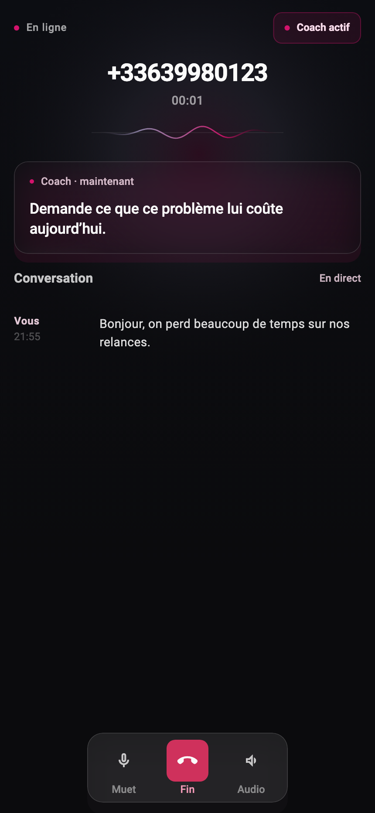
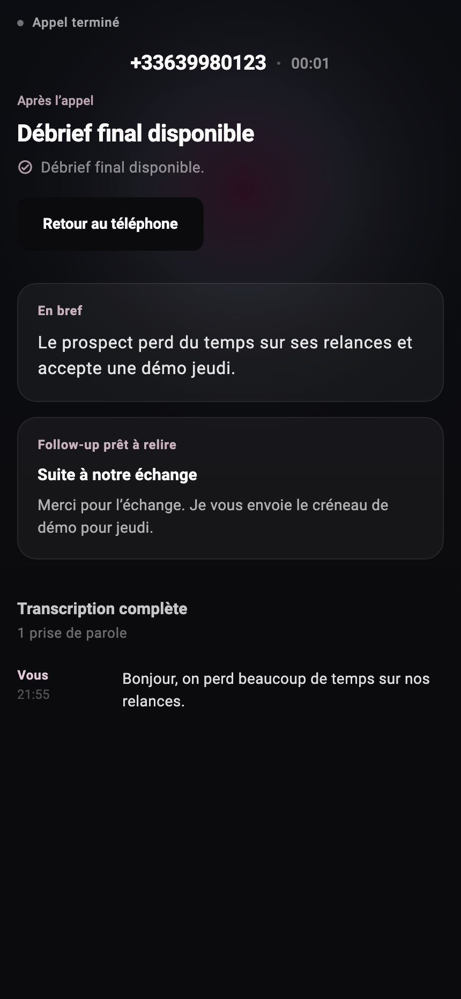
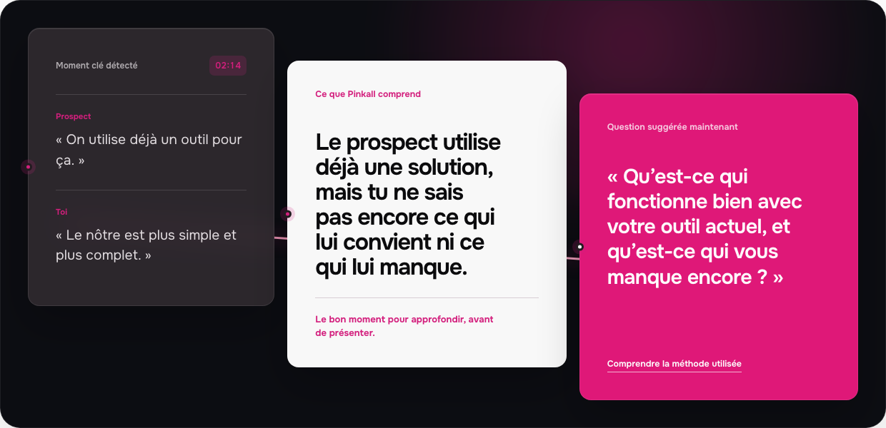
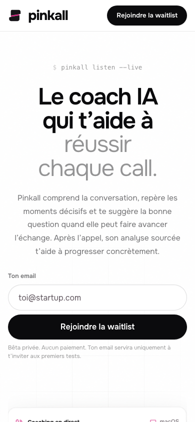

<div align="center">

<picture>
  <source media="(prefers-color-scheme: dark)" srcset="docs/brand/pinkall-lockup-dark.svg">
  
</picture>

### The sales phone that coaches you on every call

Place the call in the app. Get one useful suggestion while you talk.<br>
Hang up to notes, a follow-up draft and one thing to improve next time.

<p>
  <a href="LICENSE"></a>
  
  
  
</p>

<p>
  <a href="#how-it-works">How it works</a> ·
  <a href="#screenshots">Screenshots</a> ·
  <a href="#getting-started">Getting started</a> ·
  <a href="#repository-layout">Repository layout</a>
</p>



</div>

## What is Pinkall?

Pinkall is an experimental sales phone for B2B founders who still run their own
prospecting, discovery and demo calls. It is a proof of concept: there are no
customers, no benchmarks and no performance claims yet.

- **Call from the app.** A real outbound call through Telnyx, on macOS, iOS and Android.
- **Live transcript, per speaker.** Seller and prospect audio travel on separate tracks.
- **One suggestion at a time.** The live coach is optional and off by default. When it
  speaks, it shows a single card, never a stream of prompts.
- **A debrief when you hang up.** Summary, follow-up draft and one improvement tied to
  what was actually said.
- **Progress over time.** A descriptive history of your recent calls, without a global score.
- **Consent first.** Nothing is transcribed until the participants are informed.

Nothing in the runtime is simulated. Without provider keys the app still opens, and
says plainly that calling or transcription is unavailable.

## How it works



The live coach, drawn as a tape recorder:

| Part of the machine | What it stands for |
| --- | --- |
| Handset resting on the coupler | Call audio coming from telephony |
| Closed knife switch | Consent to transcription |
| Tape passing two heads | Backend ingestion, then live speech-to-text |
| Dial and its needle | End-of-turn detection (threshold 0.85) |
| Gantry lifting one pink card out of 50 | The single suggestion shown during the call |
| Stop key and printed ticket | The debrief produced after hang-up |

<details>
<summary><b>The same flow, as a sequence</b></summary>



</details>

Figure drawn with the [Anatomy](https://skills.wheresryan.sh/anatomy) skill.

## Screenshots

<table>
  <tr>
    <td width="33%"></td>
    <td width="33%"></td>
    <td width="33%"></td>
  </tr>
  <tr>
    <td align="center"><b>Dial</b><br>Number, contact and an optional AI briefing</td>
    <td align="center"><b>Talk</b><br>Live transcript and one suggestion</td>
    <td align="center"><b>Debrief</b><br>Summary and a follow-up ready to review</td>
  </tr>
</table>

<table>
  <tr>
    <td width="72%"></td>
    <td width="28%"></td>
  </tr>
  <tr>
    <td align="center"><b>Landing page</b>, coaching section</td>
    <td align="center"><b>Landing page</b>, mobile</td>
  </tr>
</table>

App screens are rendered off-screen from the real Flutter widgets with fictitious data.

## Built with

| Layer | Technology |
| --- | --- |
| App | Flutter and Dart, Riverpod, for macOS, iOS and Android |
| Backend | Dart HTTP and WebSocket API, deployable as a container |
| Telephony | Telnyx WebRTC, Call Control and Media Streaming |
| Speech-to-text | Deepgram Flux live, Mistral Voxtral for the final transcript |
| Coach and debrief | OpenAI, text only. Call audio is never sent to it |
| Auth and storage | Supabase Auth, PostgreSQL |
| Landing page | Vite, React and TypeScript |

## Getting started

### Landing page

```bash
cd site
npm ci
npm run dev
```

The invite page reads `VITE_PINKALL_SUPABASE_URL` and
`VITE_PINKALL_SUPABASE_PUBLISHABLE_KEY`. Every `VITE_*` variable ends up in the
client bundle, so never put a secret in one.

### App and backend

Install Flutter 3.44.3, then use the pinned wrappers:

```bash
cd app
./tool/flutter.sh pub get
./tool/check.sh
```

`check.sh` runs formatting, analysis, the API, domain, data and mobile test suites,
the macOS build and the native macOS tests.

Placing a real call needs your own Telnyx, Deepgram, Mistral and OpenAI accounts.
The variables are listed in
[`app/apps/api_agent_vocal/.env.example`](app/apps/api_agent_vocal/.env.example) and
the full setup is in [`app/README.md`](app/README.md).

## Repository layout

```text
app/
  apps/app_mobile/         Flutter app for macOS, iOS and Android
  apps/api_agent_vocal/    Dart backend: telephony, transcription and coach
  packages/core_*/         Domain, data, foundation and design system
  knowledge/coaching/      Coaching sources, claims and cards
  infra/                   Render, Cloud Run and Supabase guides
site/                      Landing page (Vite, React)
docs/                      Screenshots, figure and brand assets
```

Deeper reading: [ARCHITECTURE.md](ARCHITECTURE.md), [PRODUCT.md](PRODUCT.md) and
[`app/README.md`](app/README.md). These documents are written in French.

## Security

Never commit a `.env` file, a signing key or local configuration. To report a
vulnerability, see [SECURITY.md](SECURITY.md).

## Contributing

Contribution rules are in [CONTRIBUTING.md](CONTRIBUTING.md).

## License

Copyright (C) 2026 Clement Guyon.

Pinkall is released under the [GNU General Public License v3.0](LICENSE). You may
use, modify and redistribute it, provided that modified versions are published
under the same license. It comes with no warranty.

Third-party code vendored in `app/third_party/` and `.agents/skills/` keeps its own license.
